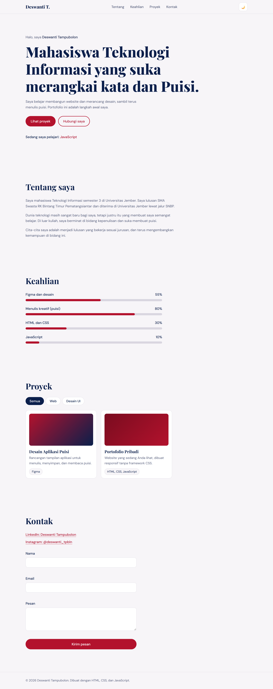
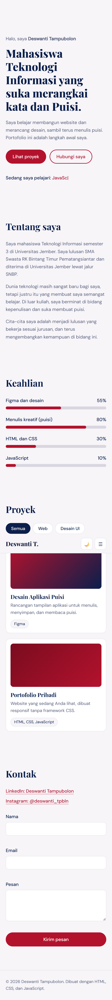

# Portofolio Deswanti Tampubolon (Tugas Slicing HTML/CSS/JS)

Website portofolio pribadi satu halaman yang responsif, dibuat dengan HTML, CSS murni, dan JavaScript (DOM) tanpa framework CSS.

**Live demo:** https://GANTI-DENGAN-LINK-DEPLOY

## Screenshot

| Desktop | Mobile |
|---|---|
|  |  |

## Penjelasan singkat

Halaman ini berisi navbar, hero, tentang saya, keahlian, proyek, kontak, dan footer. Palet warna merah dan navy dengan font serif Playfair Display untuk kesan elegan. Tampilan menyesuaikan tiga ukuran layar: mobile, tablet (768px ke atas), dan desktop (1024px ke atas). CSS ditulis dengan pendekatan mobile-first.

## Fitur JavaScript (DOM)

- Menu hamburger untuk tampilan mobile
- Mode gelap dan terang (tersimpan di localStorage)
- Efek teks mengetik di hero
- Bar keahlian yang terisi saat di-scroll (IntersectionObserver)
- Filter proyek berdasarkan kategori
- Validasi form kontak (nama, email, pesan)

## Teknologi

- HTML5 (tag semantik)
- CSS3 murni: Flexbox, Grid, CSS variables, media query
- JavaScript (vanilla)

## Struktur folder

```
portfolio/
├── index.html
├── css/style.css
├── js/script.js
├── screenshots/
└── README.md
```

## Cara menjalankan

1. Clone repo: `git clone https://github.com/USERNAME/NAMA-REPO.git`
2. Buka `index.html` di browser.

## Pembuat

Deswanti Tampubolon, Teknologi Informasi, Universitas Jember (NIM: 252410102033)
